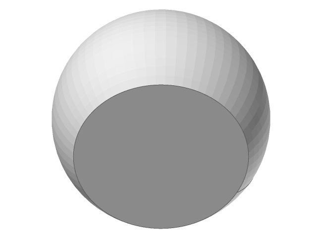
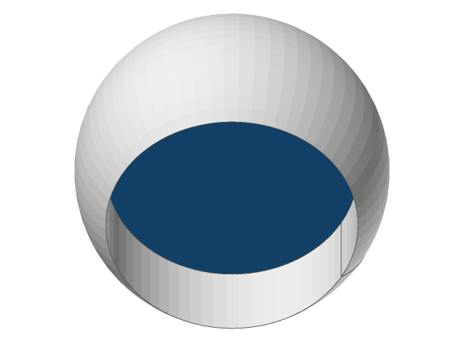

# A blind bore at a clipped sphere’s rim

The same saved operands produce a sealed opening on upstream `aeb5d4cba` and an open bore with the fix. The lower face of the 10 mm sphere is at z = −6 mm. Its rim has radius 8 mm. The 7.99999 mm cylindrical cutter starts there and reaches z = 0 mm.

| Measurement | Upstream | With the fix |
| --- | ---: | ---: |
| First axial ray hit from z = −7 mm | −6 mm | 0 mm |
| Boundary shells | 2 | 1 |
| Faces | 6 | 4 |
| Volume (mm³) | 2292.318455496415 | 2292.318455496415 |

The stock and cutter caps formed a skin with zero thickness. Both bodies pass the full body check and give the same analytic volume. At this radius the kernel represents the narrow annulus by a shared rim. A cutter more than one coincidence tolerance inside the rim leaves a measurable annular face.

| Upstream | With the fix |
| --- | --- |
|  |  |

Both bodies were produced by replaying the same corpus operands and drawn with `solidcore-diag` at azimuth 30° and elevation 55°, at 650 × 480 pixels. The same physical face, the bore ceiling at z = 0, is highlighted in both. The diagnostic's depth convention makes this an underside view. [Upstream body](before.smb.gz) · [Fixed body](after.smb.gz)

Each marked point in the section represents a circle. With the cutter 15 nm wider than the original rim, its wall meets the sphere 20.000052 nm above the cap. The cap’s face tolerance is 10 nm. The two length scales explain how the kernel could find the correct intersection and then join it to the wrong rim. [Editable VectorCraft drawing](rim-section.vectorcraft)

On unmodified upstream the eight offsets gave the same outcomes with zero kernel fixes and with all 28 enabled. At 7.99999 mm all 28 switches, enabled individually, also left the bore sealed. [Eight offsets in both configurations](baseline-matrix.tsv) · [Individual switch results](baseline-individual-flags.tsv)
