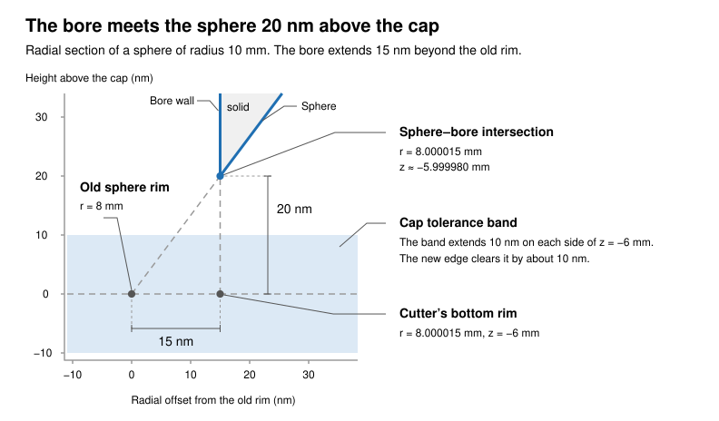

# A blind bore at a clipped sphere’s rim

The same saved operands produce a sealed opening on upstream `aeb5d4cba` and an open bore with the fix. The lower face of the 10 mm sphere is at z = −6 mm. Its rim has radius 8 mm. The 7.99999 mm cylindrical cutter starts there and reaches z = 0 mm.

| Measurement | Upstream | With the fix |
| --- | ---: | ---: |
| First axial ray hit from z = −7 mm | −6 mm | 0 mm |
| Boundary shells | 2 | 1 |
| Faces | 6 | 4 |
| Volume (mm³) | 2292.318455496415 | 2292.318455496415 |

The stock and cutter caps formed a skin with zero thickness. Both bodies pass the full body check and give the same analytic volume. At this radius the kernel represents the narrow annulus by a shared rim. A cutter more than one coincidence tolerance inside the rim leaves a measurable annular face.

| Upstream | With the fix |
| --- | --- |
|  |  |

Both bodies were produced by replaying the same corpus operands and drawn with `solidcore-diag` at azimuth 30° and elevation 55°, at 650 × 480 pixels. The same physical face, the bore ceiling at z = 0, is highlighted in both. The diagnostic's depth convention makes this an underside view. [Upstream body](before.smb.gz) · [Fixed body](after.smb.gz)

Each marked point in the section represents a circle. With the cutter 15 nm wider than the original rim, its wall meets the sphere 20.000052 nm above the cap. The cap’s face tolerance is 10 nm. The two length scales explain how the kernel could find the correct intersection and then join it to the wrong rim. [Editable VectorCraft drawing](rim-section.vectorcraft)

On unmodified upstream the eight offsets gave the same outcomes with zero kernel fixes and with all 28 enabled. At 7.99999 mm all 28 switches, enabled individually, also left the bore sealed. [Eight offsets in both configurations](baseline-matrix.tsv) · [Individual switch results](baseline-individual-flags.tsv)

## Upstream submission

The [test-only commit](https://github.com/shangaslammi/solidcraft/commit/312220fd846a4d28bdcccbd148f95f3cf6255560) reproduces the false cap. The [implementation](https://github.com/shangaslammi/solidcraft/commit/92bbf163485affb9a5cb0476fff7ae400b2063c8) is based on [SolidCraft main at `3f0967dab`](https://github.com/tangency-labs/solidcraft/commit/3f0967dabd614264fb7c0022a20a07a67ec2cf5b). On upstream `6f4ea5dd2` the eight-offset switch matrix and all 28 individual-switch results matched the earlier run. On the submission branch, the saved fixed body and its rendered PNG matched the earlier comparison byte for byte.

The integrated branch passed 25 focused kernel and Boolean tests, the corpus replay and its manifest check. All 128 offset, seam and switch combinations and 19 geometry cases passed. The 17 affected golden units covered 41,047 cases with zero changes. Formatting and both workspace Clippy checks passed on `312917ba6`. Kernel library Clippy and the WebAssembly check also passed after integrating upstream’s typed surface errors. All builds used one job.

The shared frame check replaces three copies of the same eight-epsilon test for unit lengths and perpendicular axes. With upstream `9776fb9b0` integrated, the old and shared predicates and three constructors agreed on 29 boundary and invalid frames. The bore regression, saved subtraction and 6 curve and surface tests passed. All 45,098 cases in the 18 affected golden units matched. Formatting, repository checks, both workspace Clippy checks and the kernel WebAssembly check passed with one build job. [Shared frame check](https://github.com/shangaslammi/solidcraft/commit/0ea42f5084d77a01aae5da04796449bdfb153408) · [SolidCraft main](https://github.com/tangency-labs/solidcraft/commit/9776fb9b0f94e6ec3e0ea10562c4f39e9c7b753a)

The upstream review identified rounded-outset regressions and a drilled-frustum shell with a 0.00002 mm web. The follow-up restored the outset results and checked the shell against an independent section-volume calculation. [Rounded-outset and frustum evidence](../2026-11-23-rounded-outset-review/README.md)

| Upstream item | Title |
| --- | --- |
| [Filed issue #20780](https://github.com/tangency-labs/solidcraft/issues/20780) and [report text](upstream-issue.md) | Boolean cut leaves a blind bore sealed at a clipped sphere’s rim |
| [Pull request #20844](https://github.com/tangency-labs/solidcraft/pull/20844), [submitted text](upstream-pr.md) and [draft claim](upstream-claim.md) | Booleans: open a blind bore at a clipped sphere’s rim |
