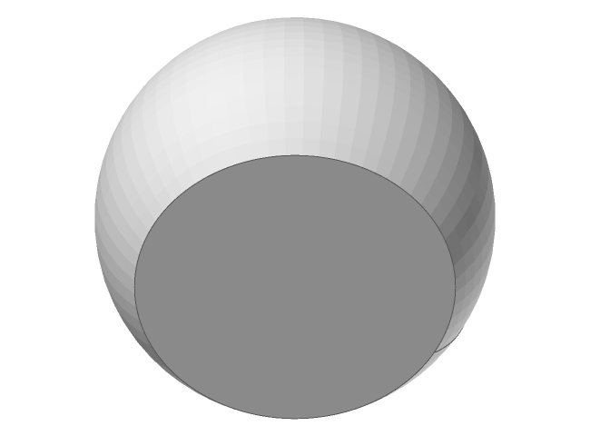
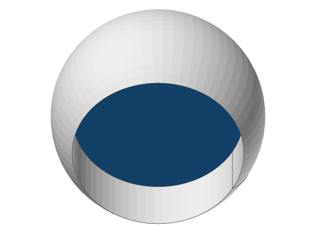

## What happened

A blind bore cut from the flat underside of a clipped sphere can remain sealed by a zero-thickness skin. The kernel reports a valid solid with the correct volume. A ray from below hits the skin at z = −6 mm. It should reach the bore ceiling at z = 0 mm.

## Reproduce

1. Make a sphere of radius 10 mm centred at the origin. Cut off the portions above z = 7 mm and below z = −6 mm. The lower face has radius 8 mm.
2. Extrude a full circle of radius 7.99999 mm from (0, 0, −6) to (0, 0, 0), along +Z, with caps. Subtract it from the sphere at the default tolerances.
3. Cast a ray from (0, 0, −7) along +Z. The operation returns six faces and two boundary shells. The expected result has one shell and four faces with the two rims represented by a shared boundary. Both volumes are 2292.318455496415 mm³.

The Rust regression builds both operands from primitives and checks two rays. The corpus case replays the saved operands and detects the two extra faces. [Native regression](https://github.com/shangaslammi/solidcraft/blob/312220fd846a4d28bdcccbd148f95f3cf6255560/solidcore/crates/solidcore-ops/tests/boolean.rs#L3451) · [Saved corpus case](https://github.com/shangaslammi/solidcraft/blob/312220fd846a4d28bdcccbd148f95f3cf6255560/solidcore/crates/solidcore/tests/kernel_cases/booleans/20780-clipped-sphere-bore-opens-at-the-rim.json)

The two pictures use the same operands and underside view. The recessed face at z = 0 is blue wherever it is visible. [Native bodies, renders, and measurements](https://github.com/shangaslammi/solidcraft/blob/50b195f027599a08a2571f4d5c5596289fadda34/work-logs/2026-11-22-clipped-sphere-pr/README.md)

| Upstream | Expected opening, rendered with the fork fix |
| --- | --- |
|  |  |

## Other radii and kernel switches

On Linux x86_64, unmodified upstream revisions `aeb5d4cba` and `6f4ea5dd2` gave the same results at all eight offsets, with zero kernel switches and with all 28 enabled. On both revisions each switch enabled individually also left the 7.99999 mm bore sealed. [Upstream revision](https://github.com/tangency-labs/solidcraft/commit/6f4ea5dd20af989b8e1e57fa197191c0eb435d6d) · [Flag-by-flag results](https://github.com/shangaslammi/solidcraft/blob/50b195f027599a08a2571f4d5c5596289fadda34/work-logs/2026-11-22-clipped-sphere-pr/baseline-individual-flags.tsv)

| Bore radius minus 8 mm | Observed on upstream |
| --- | --- |
| −0.0001 mm and 0 | The ray reaches the ceiling in one valid shell. |
| −0.00002 mm | The coincident-edges check fails. |
| −0.00001 mm | A skin seals the bore. |
| −0.000005 mm | Two body checks and record export fail. |
| +0.0000125 mm | The Boolean refuses the cut with status 1001. |
| +0.000015 and +0.00002 mm | Three and four body checks fail, respectively. Neither result exports. |

## Cause

For a bore of radius r greater than 8 mm, the cylinder meets the sphere at z = −√(100 − r²). A radius of 8.000015 mm moves that edge just over 20 nm above the original cap. The intersection search finds both rims, then can collapse them at a seam even when they are farther apart than the 10 nm coincidence tolerance. The proposed fix tests separation over the whole curve. The convex-hull property of a positive-weight rational spline gives a projection bound, and outward rounding makes that bound conservative. [Radial section](https://github.com/shangaslammi/solidcraft/blob/50b195f027599a08a2571f4d5c5596289fadda34/work-logs/2026-11-22-clipped-sphere-pr/rim-section.svg) · [Fisher, Lowther and Shene, §5](https://pages.mtu.edu/~shene/PUBLICATIONS/2004/NURBS.pdf) · [Kearfott on outward rounding](https://www.reliable-computing.org/archive/preprints/survey.pdf)

The straight rectangular groove in the broader tolerance report remains reproducible in the fork. [Related issue #20073](https://github.com/tangency-labs/solidcraft/issues/20073)
