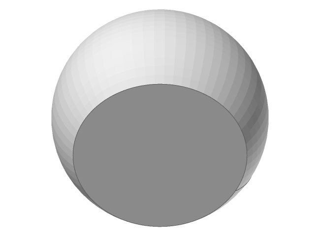
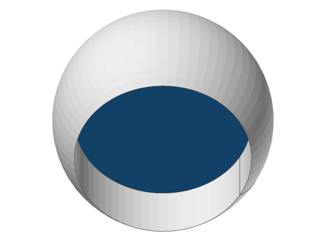
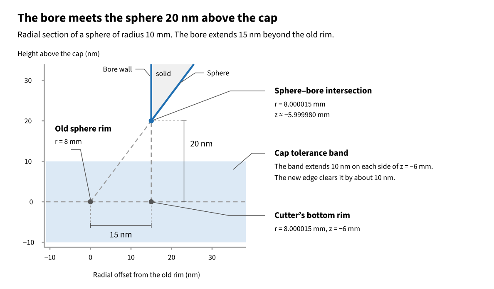

## Change

Drilling from the flat underside of a clipped sphere now opens a blind bore when the cutter is close to the face’s rim.

Fixes #20780.

Previously the cut could leave a zero-thickness cover, return an invalid body, or refuse the operation as the radius changed by a few nanometres.

The Boolean found the sphere–cylinder intersection, then sometimes treated it and an older rim as one boundary. The search can reach the sum of two local tolerances. Sharing a boundary uses the larger individual tolerance with an allowance for rounding. The fix checks separation over the whole curve before joining edges, snapping endpoints, or merging vertices. It also keeps the exact planar ellipse when the trimmed curve fits the face, including when its seam rotates.

Refs #20073. The straight rectangular groove in that issue still disappears at depths of 0.0000125 and 0.000015 mm. [Groove and overhang tolerance tracker](https://github.com/tangency-labs/solidcraft/issues/20073)

Changes a default: no

Test change: Adding one fully expressible subtraction raises the Boolean corpus count from 137 to 138 and the one-step, expressible and operation-expressible counts by one each. Three existing endpoint-snap checks now pass an explicit unrestricted endpoint mask. A new oblique crossing checks that excluding its target endpoint preserves the solved interior intersection.

Units: curve.curve_p6, curve.curve_p8, curve.ellipse_p1, curve.ellipse_p2, intersect.curve_class_p1, intersect.curve_class_p2, intersect.curve_class_p3, intersect.curve_class_p5, intersect.curve_class_p9, intersect.point_class, query.face_p2, topology.face_p3, topology.vertex, topology.proto_topology_p1, topology.proto_topology_p3, boolean.topology_intersector_p2, surface.plane_p1

## Validation

On upstream `6f4ea5dd2`, the regression hit a false cap at z = −6 mm and the corpus replay returned six faces. The first submission commit contains the regression and both operands. Replaying the same stock and cutter after the fix gives the following result. [Saved operands and regression](https://github.com/shangaslammi/solidcraft/commit/312220fd846a4d28bdcccbd148f95f3cf6255560)

| Bore radius 7.99999 mm | Upstream | With the fix |
| --- | ---: | ---: |
| First axial ray hit from below | −6 mm | 0 mm, the bore ceiling |
| Boundary shells | 2 | 1 |
| Faces | 6 | 4 |
| Volume, analytic 2292.318455496415 mm³ | 2292.318455496415 | 2292.318455496415 |

For a sphere of radius 10 mm cut at z = −6 mm, a wider bore of radius r meets the sphere at z = −√(100 − r²). At offsets +0.0000125 and +0.000015 mm the edge lies at approximately −5.999983333297 and −5.999979999948 mm, respectively. The measured heights differ from the unrounded formula by less than 5 × 10⁻¹⁵ mm in both cases. At −0.00002 mm the annulus has area π(8² − 7.99998²) ≈ 0.001005308393 mm². The checked-in regression also exercises the corresponding positive and negative offsets and the exact 8 mm rim.

- 25 focused kernel and Boolean tests passed, along with the corpus replay and the record/manifest check.
- All 128 combinations of radial offset, seam position and kernel switches passed. Another 19 checks covered sphere and bore radii, clip depths, placements and tolerances. Unmodified upstream showed the same defects with zero switches and with all 28 enabled. Each switch enabled individually also left the 7.99999 mm bore sealed. [Upstream flag comparisons](https://github.com/shangaslammi/solidcraft/blob/50b195f027599a08a2571f4d5c5596289fadda34/work-logs/2026-11-22-clipped-sphere-pr/README.md)
- Formatting, repository checks, workspace Clippy for both workspaces and the kernel WebAssembly check passed with one build job. The targeted goldens covered 41,047 cases.

<details>
<summary>Golden results for the 17 affected units</summary>

```text
PASS curve.curve_p6 cases=3138 changed=0 added=0 removed=0 broken=0 known_failing=0 rust=0.403s
PASS curve.curve_p8 cases=3069 changed=0 added=0 removed=0 broken=0 known_failing=0 rust=2.670s
PASS curve.ellipse_p1 cases=2527 changed=0 added=0 removed=0 broken=0 known_failing=0 rust=0.339s
PASS curve.ellipse_p2 cases=2107 changed=0 added=0 removed=0 broken=0 known_failing=0 rust=0.204s
PASS intersect.curve_class_p1 cases=2131 changed=0 added=0 removed=0 broken=0 known_failing=0 rust=32.037s
PASS intersect.curve_class_p2 cases=1671 changed=0 added=0 removed=0 broken=0 known_failing=0 rust=1.233s
PASS intersect.curve_class_p3 cases=3708 changed=0 added=0 removed=0 broken=0 known_failing=0 rust=4.688s
PASS intersect.curve_class_p5 cases=1411 changed=0 added=0 removed=0 broken=0 known_failing=0 rust=2.483s
PASS intersect.curve_class_p9 cases=457 changed=0 added=0 removed=0 broken=0 known_failing=0 rust=0.197s
PASS intersect.point_class cases=2520 changed=0 added=0 removed=0 broken=0 known_failing=0 rust=1.084s
PASS query.face_p2 cases=1401 changed=0 added=0 removed=0 broken=0 known_failing=0 rust=37.911s
PASS topology.face_p3 cases=2407 changed=0 added=0 removed=0 broken=0 known_failing=0 rust=29.133s
PASS topology.vertex cases=5954 changed=0 added=0 removed=0 broken=0 known_failing=0 rust=108.144s
PASS topology.proto_topology_p1 cases=1922 changed=0 added=0 removed=0 broken=0 known_failing=0 rust=1.016s
PASS topology.proto_topology_p3 cases=3013 changed=0 added=0 removed=0 broken=0 known_failing=0 rust=2.357s
PASS boolean.topology_intersector_p2 cases=913 changed=0 added=0 removed=0 broken=0 known_failing=0 rust=46.263s
PASS surface.plane_p1 cases=2698 changed=0 added=0 removed=0 broken=0 known_failing=0 rust=0.717s
goldens: 17 unit(s), 17 passed, 0 failed
```

</details>

## Screenshots of the behavior

Each picture shows the underside of the saved subtraction, from the same view. The bore ceiling at z = 0 is highlighted blue. The skin hides it on upstream.

| Upstream | With the fix |
| --- | --- |
|  |  |



At the larger radius the new edge lies beyond the cap’s 10 nm tolerance. Each marked point in the section is a circle around the bore axis. [Editable schematic and native bodies](https://github.com/shangaslammi/solidcraft/tree/50b195f027599a08a2571f4d5c5596289fadda34/work-logs/2026-11-22-clipped-sphere-pr)

## Integration status

The kernel changes applied cleanly alongside upstream’s seam-vertex changes. The workspace-wide Clippy and formatting checks passed on `312917ba6`. A later upstream change introduced typed errors in the implicit-surface routines. It touched different functions in the same file. After integrating it, the focused regressions, geometry checks, all 17 golden units, kernel library Clippy and the WebAssembly build passed on this submission. No open pull request claimed #20780 when the branch was prepared. The open coplanar-face PR classifies copies of existing edges. The new separation checks apply to intersections of two surfaces. [SolidCraft main at `3f0967dab`](https://github.com/tangency-labs/solidcraft/commit/3f0967dabd614264fb7c0022a20a07a67ec2cf5b) · [Coplanar-face edge classification](https://github.com/tangency-labs/solidcraft/pull/13562)
