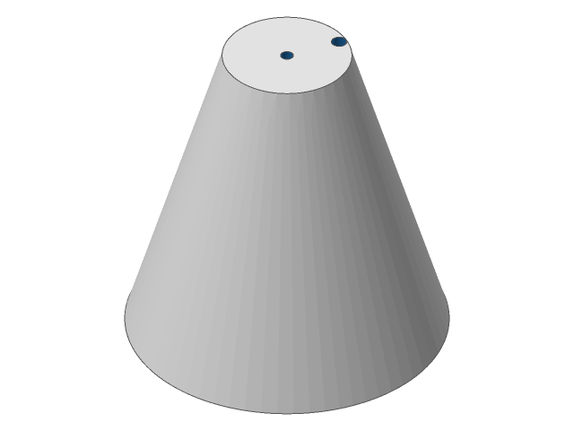
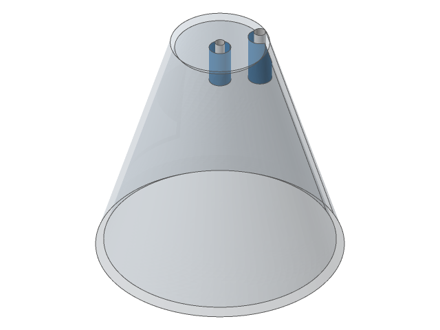

# Rounded outsets and a shell with a narrow web

The [upstream review](https://github.com/tangency-labs/solidcraft/pull/20844#issuecomment-7088942637) reported 15 changed rounded-outset rows and a drilled-frustum test that expected a refusal. These were two distinct changes in behavior.

## Rounded outsets

On the rounded outward offset of `extrudeHoles1`, both source edges had a tolerance of 0.0059574935488984 mm after earlier joins. Both owning bodies specified 0.00001 mm. Using the grown edge values to look for a new shared subinterval made the overlap resolver recreate the same group until its cycle guard refused the offset. Changing only the search reach restored the original result of 47 faces, 100 edges and 53 vertices. Changing only the tolerance used to classify the resulting curve against its faces left the cycle in place.

Each edge now contributes at most its owning body's modelling tolerance to that search, with the manager's effective tolerance as a lower bound. The contact tolerance and coordinate rounding still apply. The faces still classify the resulting interval using its source edge's approximation tolerance. When both bodies of the clipped-sphere subtraction specify a tenfold larger model zone, a cut exactly one such zone inward still shares a single rim. At offsets of −1.25 and +1.25 times the larger zone the results have five and four faces, respectively. The wider bore meets the sphere within 2 × 10⁻¹³ mm of its analytic height. [Kernel and regression change](https://github.com/shangaslammi/solidcraft/commit/8ae5a9b4c26d3fd8bb52b12ed0ffa7e6cc1d567a)

## Drilled-frustum shell

The frustum tapers from radius 25 mm at z = 0 to radius 10 mm at z = 50. The shell is offset inward by 1.2 mm. A radius 1.2 mm blind hole at x = 8.79998 mm leaves a 0.00002 mm web in the outer top face. The second blind hole runs along the axis. The resulting body passes the full kernel check, is one solid and has three loops on the top cap. Moving the rim hole to x = 8.8 mm puts it tangent to the outer top circle at (10, 0, 50). That input retains the diagnosed outline touch and the underlying edge-split failure. [Drilled input](drilled-input.smb.gz) · [Shelled result](drilled-shell.smb.gz)

| Input with both blind holes | Inward shell with the internal faces visible |
| --- | --- |
|  |  |

Both views use the same camera. In the right-hand image the conical and top faces are transparent, exposing the shell walls around the two blind holes in blue.

The drilled outer volume is π × (50(25² + 25·10 + 10²)/3 − 10·1.2² − 8·1²) = 16227.6π mm³. The inward cavity occupies 1.2 ≤ z ≤ 48.8. Its conical wall has section radius R(z) = 25 − 0.3z − 1.2√1.09. Start with the outer volume and subtract the volume of the frustum formed by R(z). Add back the central disk of radius 2.2 mm over 40.8 ≤ z ≤ 48.8 and the intersection of the cavity disk with a disk of radius 2.4 mm at x = 8.79998 over 38.8 ≤ z ≤ 48.8. The eccentric disk is wholly inside up to z = 41.8239440631 mm. Integrating the circular lens above that height gives a material volume of **9243.7803299802 mm³**. The native shell measures **9243.7803299803 mm³**.

## Verification

The rounded-outset integration test, the WR-533 refusal regression, both frustum cases, the saved bore and its Boolean regression passed. All 45,692 golden rows in 19 affected units matched their committed outputs. The offset unit covered 594 rows including 26 recorded baseline failures. The 128 offset, seam and switch combinations passed again, as did 19 geometry and placement controls and three checks at tenfold model tolerances. Both workspaces passed Clippy, and the kernel WebAssembly check passed. [Upstream PR #20844](https://github.com/tangency-labs/solidcraft/pull/20844)
